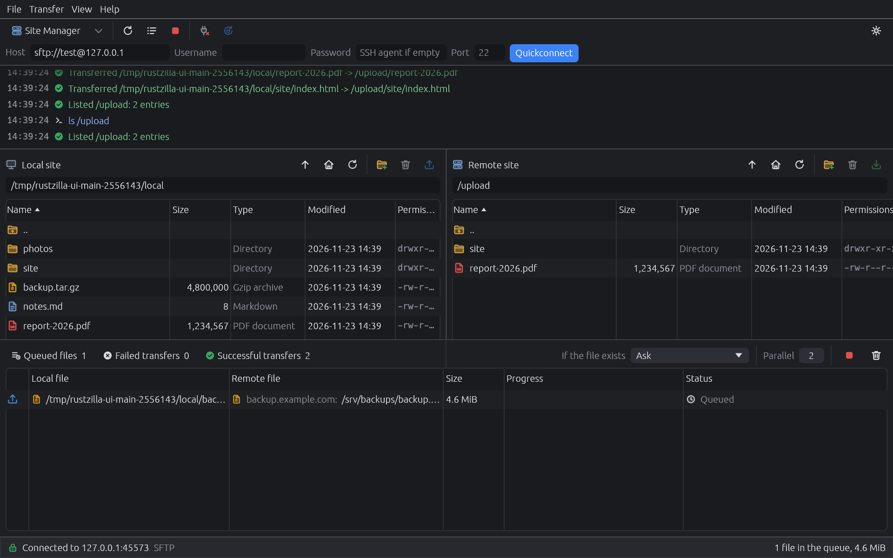

# RustZilla

A fast, native SFTP client in the spirit of FileZilla, written in Rust on the
same stack as [DbCraft](https://github.com/ortic/dbcraft): eframe/egui 0.36
for the UI, russh (pure Rust, on ring) for SSH, and DbCraft's own FIDO code
for security keys.



## Features

- **SFTP** over SSH: browse, upload, download, create directories, rename,
  delete (recursively), change permissions.
- **FileZilla's layout**: Quickconnect bar, message log, local and remote
  panes side by side, transfer queue with queued, failed and successful
  transfers, status bar.
- **Transfers**: whole directories, several in parallel (each on its own
  SFTP channel over the one SSH login), progress, speed and time left,
  cancel and retry, resume. When the target exists: ask, overwrite,
  overwrite if the source is newer, resume, or skip. File times are kept.
- **Drag and drop** between the panes, and files from the desktop onto the
  window to upload them.
- **Site Manager**: saved servers in `sites.toml`; passwords and passphrases
  in the OS keychain, never in files.
- **Logins**: password (and keyboard-interactive), key files (OpenSSH, PEM,
  PuTTY `.ppk`), the SSH agent (ssh-agent, Pageant, Windows' OpenSSH agent).
- **Security keys** (YubiKey and other FIDO2/U2F keys): the key files of
  `ecdsa-sk` and `ed25519-sk` keys (`ssh-keygen -t ed25519-sk`) sign with the
  key, as in DbCraft:
  - Linux (hidraw) and macOS (hidapi): CTAP2 over USB HID, PIN protocols one
    and two, U2F for older keys. When the key needs its PIN
    (`-O verify-required`), RustZilla asks for it; then it asks you to touch
    the key.
  - Windows: the WebAuthn API, with Windows' own dialog for touch and PIN.
  - With several keys plugged in, the one that holds the credential signs.
- **Polished UI**: hand-drawn SVG icons in DbCraft's style (file types,
  folders, transfer directions, security keys), DbCraft's dark and light
  themes (following the system, or chosen), a toolbar, empty states and
  clear dialogs.
- **Host keys** are checked against `~/.ssh/known_hosts` and RustZilla's own
  file; an unknown key is shown with its fingerprint to trust, a changed key
  stops the connect.


## Building

```sh
cargo run -p rustzilla-app            # debug
cargo run --profile fast -p rustzilla-app
cargo build --release -p rustzilla-app
```

On Linux the security key is read from `/dev/hidraw*`: your user needs
access, which the udev rules of `libfido2` (package `libfido2-1` or
`fido2-tools`) or `yubikey-manager` grant.

## Using it

- **Quickconnect**: `host`, `host:port` or `sftp://user@host:port/path`.
  Without a password the SSH agent's keys are used.
- **Site Manager** (File → Site Manager): for key files and security keys
  choose the logon type *Key file / security key* and pick the key file
  (e.g. `~/.ssh/id_ed25519_sk`). The passphrase field is for encrypted key
  files; a security key's PIN is asked for when it's needed.
- Keys: F5 refresh, Backspace parent directory, Delete, F2 rename, Ctrl+A
  select all, on the pane last clicked.

Files: sites in the config directory (`~/.config/rustzilla/sites.toml` on
Linux), trusted host keys and logs in the data directory
(`~/.local/share/rustzilla/`). Help → About shows where.

## Tests

```sh
cargo test --workspace
```

runs everything, including the SFTP round trip and the transfer queue
against an SFTP server in the process (`rustzilla-sftp`'s `test-server`
feature), the login with a security key emulated in software, and the UI
scenes headless. With `RUSTZILLA_SCREENSHOTS=<dir>` the UI scenes are
rendered as PNGs there (the ones in `docs/` are made that way).

Against a real OpenSSH server:

```sh
docker compose up -d
RUSTZILLA_TEST_SFTP=1 cargo test -p rustzilla-sftp --test openssh
```

## Layout

- `crates/rustzilla-sftp`: SSH login (`ssh.rs`, from DbCraft's tunnels),
  security keys (`fido/`, `ssh/security_key.rs`, from DbCraft), SFTP
  operations and transfers (`sftp.rs`), blocking API on a tokio runtime per
  connection.
- `crates/rustzilla-app`: the egui app: panes (`pane.rs`), the session
  worker (`session.rs`), the transfer queue (`transfers.rs`), the Site
  Manager, dialogs.

## License

MIT or Apache-2.0, at your option.
